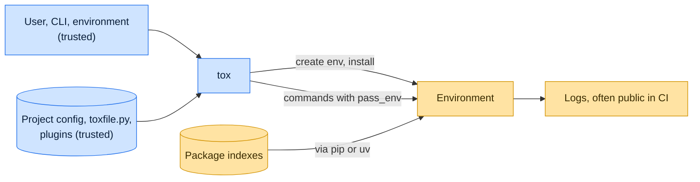

# Threat model

This model says what tox trusts, where untrusted input enters, and which guarantees hold at each boundary, so a report
can be classified as a vulnerability or a bug. [SECURITY.md](SECURITY.md) covers reporting; if the two disagree,
SECURITY.md wins and we fix this file.

## How tox works

tox finds its configuration (`tox.ini`, `setup.cfg`, `pyproject.toml` or `tox.toml`) in the current directory or the
nearest parent that has one, loads installed plugins and an optional `toxfile.py`, and, if `requires` asks for a newer
tox or plugins, provisions them first. For each environment it creates a virtual environment, installs the package and
dependencies through pip or a plugin such as tox-uv, and runs the configured commands with only the variables `pass_env`
allows plus a default set. Echoed commands mask the values of secret-looking `--name=value` flags, and the per-command
log files mask variables with secret-looking names.

## Compared with similar tools

We drew the boundary where comparable projects in other ecosystems draw theirs. The shared rule, stated by the
[Node.js threat model](https://github.com/nodejs/node/blob/main/SECURITY.md#the-nodejs-threat-model), is that a report
which first needs a trusted element compromised is out of scope; the first triage question, as
[DOMPurify](https://github.com/cure53/DOMPurify/blob/main/SECURITY.md#what-we-consider-a-vulnerability) puts it, is what
the attacker controls.

| Project                                                                                                | Language   | Where it draws the line                                                                                                                                |
| ------------------------------------------------------------------------------------------------------ | ---------- | ------------------------------------------------------------------------------------------------------------------------------------------------------ |
| [Lefthook](https://github.com/evilmartians/lefthook/security/policy)                                   | Go         | Runs the commands its configuration names by design; that is not a vulnerability.                                                                      |
| [Vitest](https://github.com/vitest-dev/vitest/security/policy)                                         | JavaScript | Trusts the developer, their machine, the config file, plugins and every project file; a report counts only if it needs no trusted element compromised. |
| [Hatch](https://github.com/pypa/hatch/security/policy)                                                 | Python     | Assumes the user has full control over the build environment.                                                                                          |
| [Git `safe.directory`](https://git-scm.com/docs/git-config#Documentation/git-config.txt-safedirectory) | C          | Since CVE-2022-24765 Git ignores repositories owned by another user; tox does not yet check who owns the directory it takes configuration from.        |

## Trusted

An attacker who controls any of these already has what tox could give them:

- The user, the command line and the process environment.
- The project directory: its tox configuration, `toxfile.py`, packaging metadata and code.
- Installed tox plugins and the packages `requires` provisions.
- The configured package indexes and requirement files, which the installer fetches.

## Untrusted inputs

| Input                       | Comes from                                                | What tox guarantees                                                                                                |
| --------------------------- | --------------------------------------------------------- | ------------------------------------------------------------------------------------------------------------------ |
| Values echoed in tox's logs | Commands containing tokens, often shown in public CI logs | Values of `--name=value` flags and variables whose names match the gitleaks `generic-api-key` keywords are masked. |
| Variables not in `pass_env` | The invoking environment                                  | Not passed to environment commands, apart from tox's documented default set.                                       |

## Threats and controls

| STRIDE                 | Threat                                                                    | Control                                                                               |
| ---------------------- | ------------------------------------------------------------------------- | ------------------------------------------------------------------------------------- |
| Information disclosure | A token passed as `--token=...` appears in a public CI log line.          | Redaction of secret-looking flag values in echoed commands.                           |
| Tampering              | Recreating an environment deletes a directory outside the work directory. | Environments live under `work_dir`; report any delete outside it.                     |
| Elevation of privilege | A substituted value splits into an extra command or option.               | Commands are argument lists; report any data value that crosses an argument boundary. |
| Elevation of privilege | A config file in a parent directory owned by another user is picked up.   | Accepted risk today (see below); run tox only in trees you control.                   |

## Release chain

Releases run on the shared [tox-dev/github-workflows](https://github.com/tox-dev/github-workflows) pipeline. A release
App, not a person, pushes the release commit and tag; the build installs its tools from a hash-checked `pylock.toml`
resolved with a seven-day upload cooldown by default; PyPI receives the files through
[trusted publishing](https://docs.pypi.org/trusted-publishers/) with attestations, and the GitHub Release is immutable.
Every workflow pins third-party actions to a commit SHA.

## Vulnerability or bug

| Report                                                              | Verdict             | Why                                                  |
| ------------------------------------------------------------------- | ------------------- | ---------------------------------------------------- |
| `tox -e py` echoes `--password=hunter2` unmasked                    | Vulnerability       | The redaction guarantee is broken.                   |
| A cloned project's `commands = rm -rf ~` deletes the home directory | Not a vulnerability | The project configuration is trusted.                |
| Test code reads a CI secret through `/proc/<ppid>/environ`          | Not a vulnerability | `pass_env` is not a sandbox.                         |
| `tox` in `/tmp/work` uses `/tmp/tox.ini` another user planted       | Accepted risk       | tox walks up parent directories; see accepted risks. |

## Severity

- **High:** a crafted checkout or a race makes tox delete, overwrite or disclose a file outside its work, environment
  and package directories, or tox prints a credential its redaction rules cover.
- **Medium:** a data value crosses an argument boundary into an extra command or option, provisioning selects an
  unintended tox package or interpreter, or a journal stores sensitive data outside the project.
- **Low:** a crash, hang or terminal effect without code execution, or corruption limited to a disposable environment.

## Accepted risks

- Configuration discovery walks up parent directories without checking ownership, as Git did before `safe.directory`. Do
  not run tox below a directory other users can write, such as `/tmp`.
- Redaction is keyword based: it masks inline `--name=value` flags and named variables, not space-separated values or
  arbitrary output.

## Keeping this current

Revisit this model when tox gains a new input source, network access, a new way to run code, or a new place it writes
to, and whenever an advisory is published.
